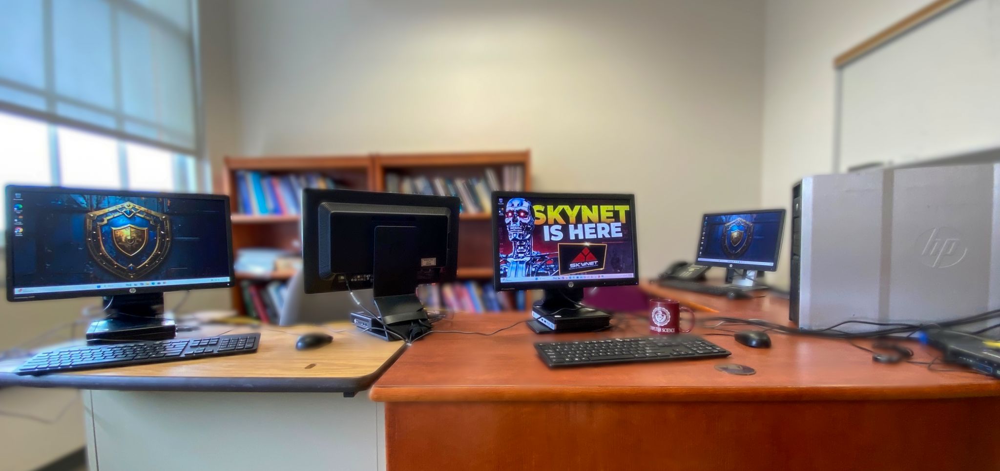

# Commonwealth University Bloomsburg SOC Lab

**Dr. Atdhe Buja | SOC Lab development and independent-study instruction | Fall 2025–present**  
**Location:** Ben Franklin Hall, Commonwealth University of Pennsylvania, Bloomsburg campus, Pennsylvania

I built and developed an educational Security Operations Center (SOC) lab and a hands-on independent study for Digital Forensics and Cybersecurity students. Students investigate simulated incidents, correlate threat intelligence, collect endpoint evidence, and document response decisions using SOC platforms and analyst workflows.

The lab began in Fall 2025 and continued through Spring 2026 and the current Fall 2026 semester. My next steps are continued delivery in Spring 2027 and a planned special-topic offering in Fall 2027, working toward approval as a regular program course.

[University feature article](https://www.commonwealthu.edu/news/building-cybersecurity-workforce-soc-lab-experience-cu-bloomsburg) · [My website](https://www.atdheb.com) · [Professional profile](https://github.com/atdhebuja)

## My contributions

- Designed and developed the lab infrastructure and its evolution from architecture version 1 to version 2.
- Integrated case management, enrichment, threat intelligence, network monitoring, endpoint investigation, and SIEM-based analysis into teaching workflows.
- Prepared the Fall 2026 version of a 15-week assignment manual, including investigation scenarios, deliverables, analyst questions, and portfolio guidance.
- Supervised students as they investigated simulated events, explained findings, and documented SOC decisions.
- Developed the SOC Talent Bridge Initiative concept and shared an outreach overview with industry professionals.
- Initiated communication with Pennsylvania State Police PA CyberCom, including an initial meeting, sharing selected student CVs for potential workforce opportunities, and an invitation to visit the lab.

The university's May 11, 2026 article identifies me as the supervising professor and confirms operation since Fall 2025. Details about curriculum development and outreach are my own professional account. PA CyberCom engagement is an ongoing contact; no formal partnership, completed visit, or hiring outcome is claimed.

## Explore the work

| Portfolio component | What it shows |
| --- | --- |
| [Lab architecture](docs/architecture.md) | Historical diagrams and the role of each platform |
| [Development timeline](docs/timeline.md) | Completed, ongoing, and planned stages |
| [15-week curriculum overview](docs/curriculum-overview.md) | Progression from SOC foundations to integrated investigation |
| [Week 12 public sample](labs/week-12-endpoint-forensics/README.md) | Windows and Linux endpoint investigation and evidence-based reporting |
| [Week 13 public sample](labs/week-13-adversary-detection/README.md) | Controlled emulation, SIEM correlation, and detection-gap analysis |
| [Teaching and assessment](docs/teaching-and-assessment.md) | Supervision, student deliverables, and proposed public sample rubric |
| [SOC Talent Bridge Initiative](docs/soc-talent-bridge.md) | Workforce vision and current outreach status |
| [Lab photo gallery](docs/photo-gallery.md) | Lab facilities and instructor/student photographs |
| [Sources and artifact provenance](docs/sources-and-provenance.md) | Origin of historical materials and newly prepared samples |

## Selected teaching materials

I am publishing two adapted weeks rather than the full assignment book. Week 12 demonstrates cross-platform forensic investigation; Week 13 demonstrates how students compare emulated behavior with detections and identify gaps.

The accompanying CSV and JSON files are **new synthetic portfolio fixtures**, not original student submissions, actual endpoint collections, or exports from a university incident. They support offline review without publishing the full course manual or platform credentials. The source manual remains private.

The source diagrams describe an educational architecture. Their example ATT&CK labels are not evidence of validated detection coverage across every listed technique. See the [architecture notes](docs/architecture.md).

## SOC Talent Bridge vision

I aim to connect supervised SOC learning with practitioner feedback, mentorship, lab demonstrations, and appropriate internship or employment opportunities. The [outreach overview](assets/outreach/soc-talent-bridge-overview.pdf) describes the concept; the [initiative note](docs/soc-talent-bridge.md) records the current status.

## Current status

As of October 2026, Fall 2026 independent-study delivery is ongoing. Spring 2027 and Fall 2027 plans are prospective. Permanent course approval is a future objective. This repository documents an educational simulation environment and my professional contribution; it is a personal portfolio rather than an official university service publication.

## Contact

Dr. Atdhe Buja · abuja@commonwealthu.edu · [atdheb.com](https://www.atdheb.com)
