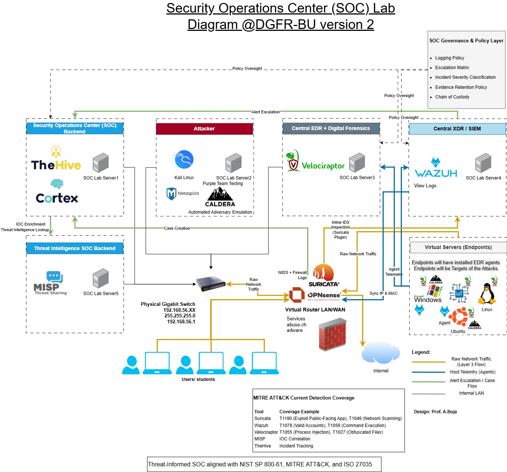

# Educational SOC Lab architecture

[Architecture version 1 PDF](../assets/architecture/soc-lab-v1.pdf)

## Evolution

Version 1 represents the initial Fall 2025 design: case management/enrichment, attacker and IDS tools, endpoint forensics, and threat intelligence connected through a lab switch and virtual router. Version 2 is the expanded design associated with Spring 2026 onward, adding a distinct SIEM/XDR role, Caldera-based emulation, and governance concepts.

The server labels in the diagrams identify architectural roles. They do not establish a verified physical host count, resource allocation, or identical deployment in every semester.

| Function | Platforms shown or used in the assignment manual | Teaching purpose |
| --- | --- | --- |
| Case management | TheHive | Record cases, evidence, tasks, decisions, and handoffs |
| Enrichment | Cortex | Evaluate observable context and analyzer results |
| Threat intelligence | MISP | Manage indicators and examine correlations |
| Network visibility | Suricata, OPNsense, Wireshark | Review traffic and network alerts in the controlled lab |
| Endpoint collection | Velociraptor | Collect and interpret Windows/Linux artifacts |
| SIEM and endpoint telemetry | Wazuh | Search events, evaluate alerts, and correlate activity |
| Controlled simulation | Caldera, Kali Linux; Metasploit appears in the historical diagrams | Produce authorized lab behaviors for investigation |
| Targets | Windows, Linux/Ubuntu, and Raspbian systems; IoT is represented in the design | Compare evidence across endpoint types |

## Investigation workflow

An analyst reviews a network or host alert, creates a case, enriches relevant observables, checks intelligence context, collects endpoint evidence, and documents findings and next actions. Some transfers can be performed manually. The workflow description does not claim every platform connection is fully automated.

## Reading the historical diagrams

- Network addresses are historical lab examples, not connection instructions for a public service.
- The version 2 governance panel represents logging, escalation, severity, retention, and chain-of-custody concepts; the drawing alone does not prove implementation of each policy.
- The box labeled current ATT&CK detection coverage should be read as illustrative technique examples. Actual coverage requires technique-specific testing, telemetry review, and recorded results.
- A tool logo or installed agent does not, by itself, establish successful integration or a detection outcome.

## Framework context

The original materials reference incident handling, NICE workforce concepts, and MITRE ATT&CK. NICE describes workforce competencies; NIST SP 800-61 addresses incident response. They are separate resources.

The university article refers to SP 800-61 Revision 2. NIST published Revision 3 in April 2025, superseding Revision 2. This portfolio retains the historical reference and points readers to Revision 3 for current incident-response guidance. It does not retroactively claim the entire manual was redesigned for Revision 3.

[Current NIST SP 800-61 Revision 3](https://csrc.nist.gov/pubs/sp/800/61/r3/final)
