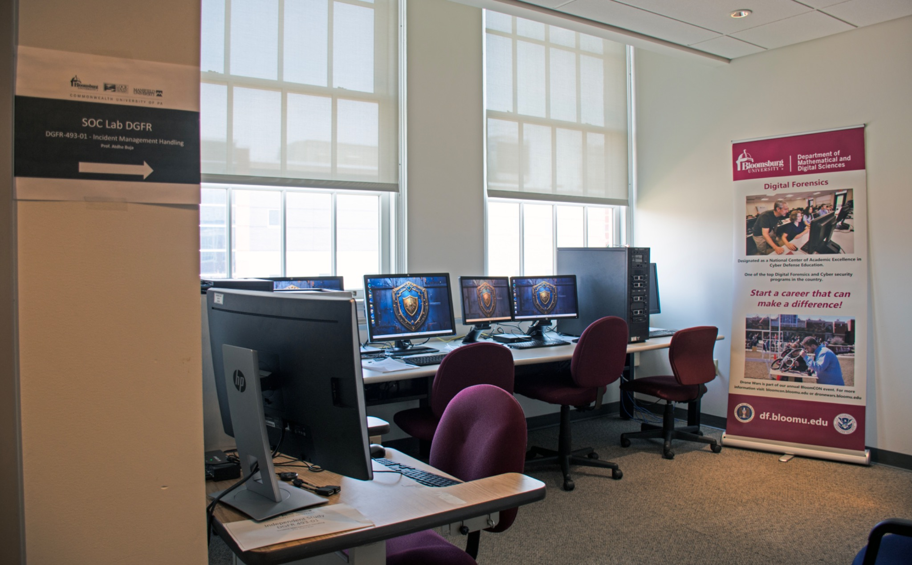
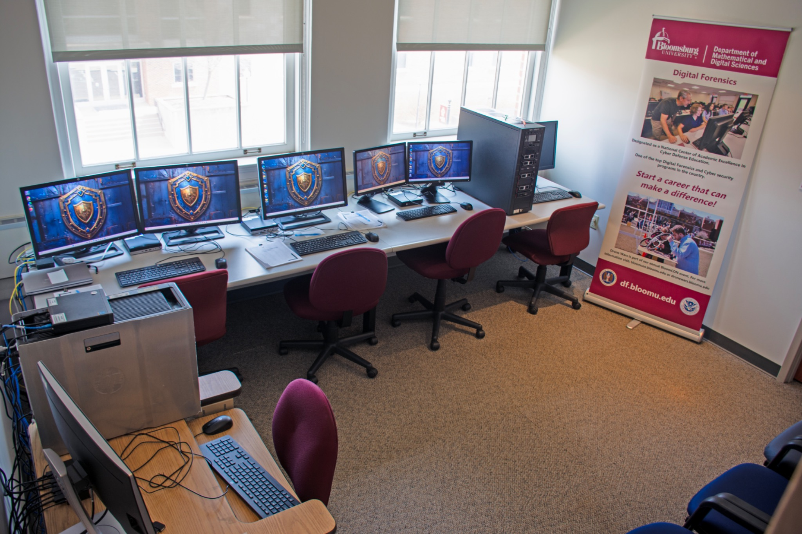
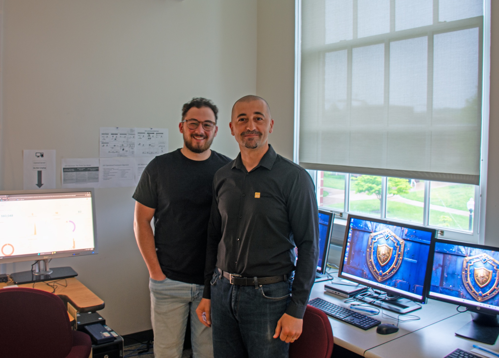
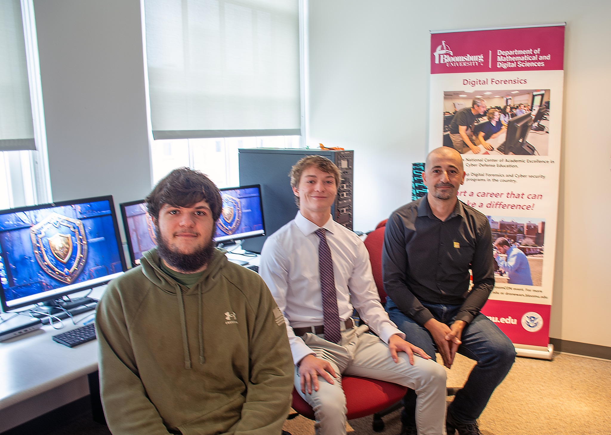

# SOC Lab photo gallery

The author supplied these photographs from the lab's early development and student activity during Fall 2025 and Spring 2026. Individual photograph dates have not been independently established.

## Lab facilities

SOC Lab facilities at Commonwealth University–Bloomsburg.

Workstations used for the educational SOC environment.

## Instructor and students

Dr. Atdhe Buja with a student in the lab. No student name or employment outcome is attributed.

Instructor and students in the educational lab. Photographs show facilities and participation; they are not evidence of a specific assessed result.

Photographs are supplied by the author. Public reuse of identifiable student photographs should follow the permissions applicable to the images.
